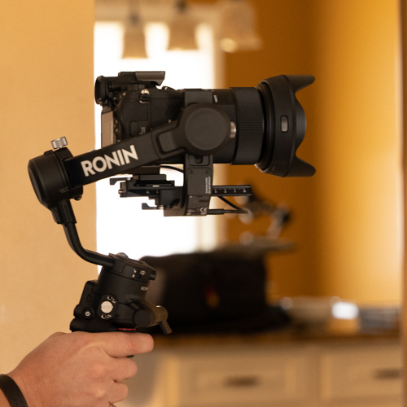
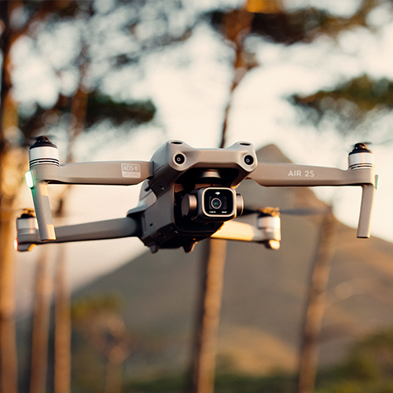

<section class="hero-area">
  

    

      

        

          

            <h1 class="hero-heading">
              {{page.title}}
            </h1>
            
{{page.callout}}

          

        

      

    

    

      <i class="fa fa-arrow-down"></i>
    

  

</section>

  

    

      

        <h2 class="display-6 mt-0 mb-3">Cinematic Videography</h2>

        <blockquote>
          94% of marketers reported that video converted <small>[...]</small> better than any other content. <a href="https://www.vidyard.com/blog/benefits-of-video-marketing-for-small-businesses/" target="_blank"><i class="fa fas fa-external-link"></i></a>
        </blockquote>

        
Captivating videos have the ability to do what photos can't... they give your customers a greater feeling of trust when thinking about using your products and services. Plus, if stats are more your thing... <a href="https://optinmonster.com/video-marketing-statistics-what-you-must-know/" target="_blank">84% of people say they've been convinced to buy a product or service by watching a brand's video. <i class="fa fas fa-external-link"></i></a>

        
Posting a standard commercial is no longer enough in the <em>creator economy fueled</em> world we are living in. In today's TikTok, YouTube, and Instagram consuming society; your customer wants more. Whether it's product demonstrations, educational content, or vlog style posts to connect personally with your target customer; I can help you create the perfect content strategy that will convey your message to your customers.

        <a class="btn btn-outline-dark" href="#Contact">Grab Attention <i class="fas fa-level-down"></i></a>
      

      

        
      

    

  

  

    

      

        <h2 class="display-6 mb-3">Engaging Drone Footage</h2>

        <blockquote>
          Drone videography is perfect for capturing a distinct vantage point of your business through a bird's eye point-of-view. <a href="https://eon-media.com/insights/top-5-benefits-of-drone-videography-for-your-business/" target="_blank"><i class="fa fas fa-external-link"></i></a>
        </blockquote>

        
Using video with drone footage will demand local customers attention. As your customers insessantly scroll through their social media feeds they will be drawn naturally to these videos because they recognize the area. This gives your marketing videos a higher chance of connecting with the intended audience and therefor more likely to communicate your message.

        <a class="btn btn-outline-dark" href="#Contact">See a Different View <i class="fas fa-level-down"></i></a>
      

      

        
      

    

  

<section class="service-area bg-primary bg-gradient pt-100 pb-90">
  

    

      

        

          <h1 class="m-0 p-0">Rank Higher on Google with</h1>
        

        
        
You can leverage YouTube to get to the top of many very competitive search terms for the area around your business and I can teach you how!

        <a class="btn btn-outline-dark" href="#Contact">Rank Higher <i class="fas fa-level-down"></i></a>
      

    

  

</section>

<section class="service-area pt-100 pb-90">
  

    

      

        
      

      

        
Fabricating new business relationships is difficult. Given an opportunity, I believe that I will be an important ally in your marketing strategy.

        
&mdash; <strong>Chris Honniball</strong>, Owner

        <a class="btn btn-outline-dark" href="#Contact">Let's Talk <i class="fas fa-level-down"></i></a>
      

    

  

</section>



  

    

      

        

          <h1 class="mb-4">Other Creative Services</h1>
          
No matter what you're looking to achieve with video I can help you create a campaign that will increase ROI and improve your target customer engagement.

          <ul class="list-unstyled lead fw-normal mt-4">
            <li>Social Media Strategy</li>
            <li>Website Design Consultation</li>
          </ul>

          <a href="#Contact" class="btn cta-btn mt-4">Plan Your Project <i class="fa fa-level-down"></i></a>
        

      

    

  

