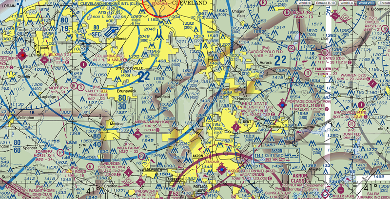

Hop on Amazon and search for drones and you'll get a bevy of options that you can purchase for a _pretty reasonable_ price. Does this mean that it's in your business' best interest to just purchase a drone and get the aerial shots that you want on your own. Probably not!

Here are 5 simple reasons why, rather than purchasing a drone and sending it into the air, you should hire a professional to conduct drone missions for your business.

## 1. FAA Part 107 Certification

To operate a drone in FAA airspace legally you have to have a _drone license_. Or... more specifically... <a href="https://www.dronepilotgroundschool.com/drone-license/" target="_blank" class="text-reset">if you're looking to fly a drone for any non-recreational purpose, you must get a Remote Pilot Certificate from the Federal Aviation Administration (FAA). This certificate is commonly known as a drone license, Part 107 license, or Part 107 certificate. <i class="fa fas fa-external-link text-reset"></i></a>

<blockquote>
  Financial compensation, or the lack of it, is not what determines if the flight is recreational or commercial. <small>[...]</small> Non-recreational purposes include things like taking photos to help sell a property or service, roof inspections, or taking pictures of a high school football game for the school's website. Goodwill or other non-monetary value can also be considered indirect compensation. This would include things like volunteering to use your drone to survey coastlines on behalf of a non-profit organization.
   &mdash; <a href="https://www.faa.gov/uas/recreational_fliers/" target="_blank">FAA</a>
</blockquote>

The FAA isn't exactly clear if _beer and hotdogs_ are considered a _indirect compensation_ for taking snaps and video of your friend's house. However, business advertising definietly is considered as a commercial operation. It's better to stay _safe and legal_ when using a drone to produce advertising content for your company.

**Hiring a licensed drone pilot ensures that your company conducting drone operations legally.**

## 2. Airspace Clearance

Do you know what _Class G Airspace, Flight Restricted Zones, METAR, or NOTAMS_ are referring to? If not, then you probably need to hesitate when you are thinking about sending up a _remotely controlled robot with a camera_ into the air.

<blockquote>
  Airspace classifications tell you where and when you can fly your drone and what, if any, permissions you will need to obtain prior to flight. These classifications will also tell you if there are particular activities you should be aware of to ensure safe flying.
   &mdash; <a href="https://www.dronegenuity.com/navigating-airspace-classifications/" target="_blank">Dronegenuity</a>
</blockquote>

Let's reference the following image for a moment.

This image shows the airspace in Northeast Ohio from just south of Cleveland to slightly north of the Akron-Canton Airport. In this image we can see a lot of different markings that tell us if drone operations are allowed in the area and whether or not we are required to get an approval to send our drone into the air. And the answer to your question of "where does controlled airspace start" is _at the surface_ (I.e. the ground). Sure, you're not likely to get in trouble flying the drone around your yard at your house. But... **that is legally controlled airspace and you need to know the proper laws before you fly**.

**Hiring a knowledgeable drone pilot ensures that your company has the proper clearance for drone operations.**

## 3. Insurance Coverage

As a business owner I'm sure you know the importance of insurance. Legally businesses are required to have all kinds of different coverages based on what their primary operations are. Drone operations _are a little different_ than a typical business.

<blockquote>
  The Federal Aviation Administration (FAA) has yet to define any rules about insurance for drones. This means the federal government will not compel you to obtain liability coverage.
   &mdash; <a href="https://www.adorama.com/alc/do-i-need-drone-insurance/" target="_blank">Adorama</a>
</blockquote>

Let's face it... things can happen when you put a _remote controlled flying robot_ into the air and I want both of us to be protected. I hold general liability, property damage, and bodily injury coverage to make sure that we're both covered in the event of an accident.

**Hiring a insured drone pilot ensures that your company and your pilot are completely covered.**

## 4. Flight Experience

Experience with the tools of any trade produce better results. When you see a photo from a cell phone vs a professional photographer you can certainly tell the difference. When you watch a TikTok video vs watching your favorite movie you can instantly see the difference in the angles, lighting, and professionalism. Drone videos and photos share that same benefit from an experienced pilot.

<blockquote>
  The truth is that, for the most part, it actually is quite difficult to fly a drone because of the very fact that you are behind the controls of a pretty fragile device that can easily crash and get broken when you make a simple mistake while flying it.
   &mdash; <a href="https://www.droneblog.com/how-hard-is-it-to-fly-a-drone-insights-from-a-beginner/" target="_blank">Droneblog</a>
</blockquote>

Composition, lighting, correct time of day, exposure, flight path, and many other factors determine the quality of your aerial drone footage.

**Hiring a professional drone pilot ensures that you get the best possible imagery.**

## 5. Potential FINES!!!

Yes you can get a pretty good drone for a couple hundred dollars from Amazon. But... Operate it illegally and face huge fines imposed by the FAA!

<blockquote>
  FAA confirmed in writing the penalties that may apply. For an unlicensed pilot, the fine is $1,100 per event/flight where the images are used commercially. Perhaps more importantly, the fine for the real estate agent who hired unlicensed pilot is $11,000.
   &mdash; <a href="https://www.pinnaclerealestatemarketing.com/11000-fine-for-unlicensed-drone-operators/" target="_blank">Pinnacle Real Estate Marketing</a>
</blockquote>

The FAA searches online videos with drone footage and checks to see if the pilot is licensed to fly commercially. I'm not going to say that every video is caught or even that the majority are. The pure fact is that you _could get caught_. It's up to you whether or not the risk is worth the reward but...

**Hiring a licensed drone pilot ensures that your company conducting drone operations legally.**
